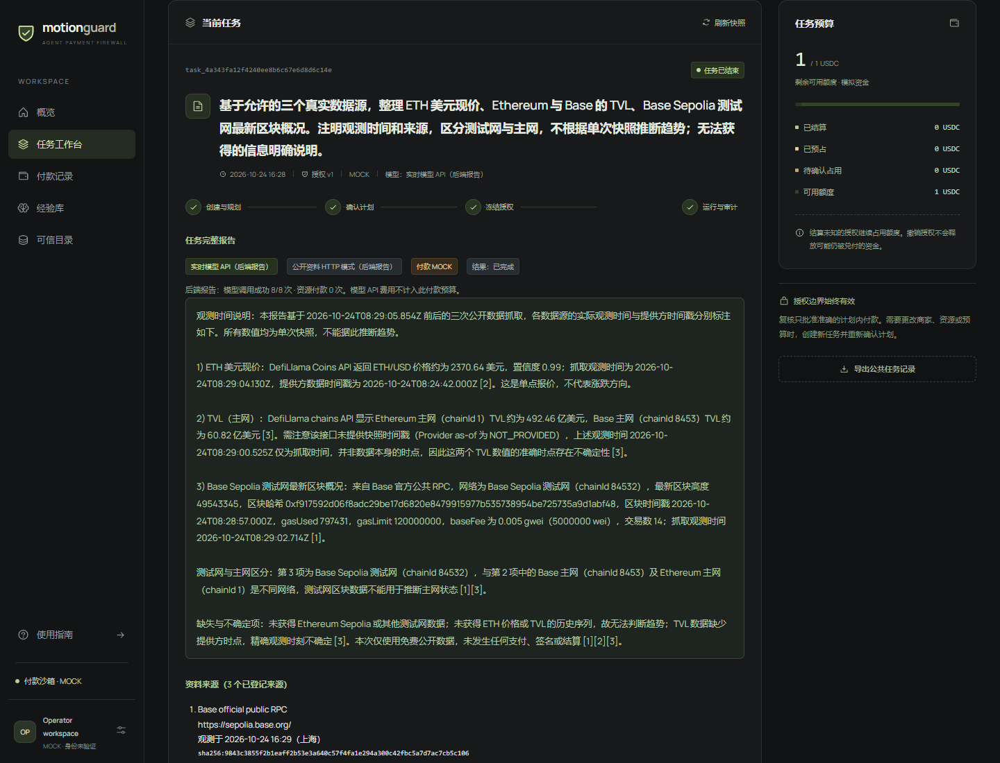
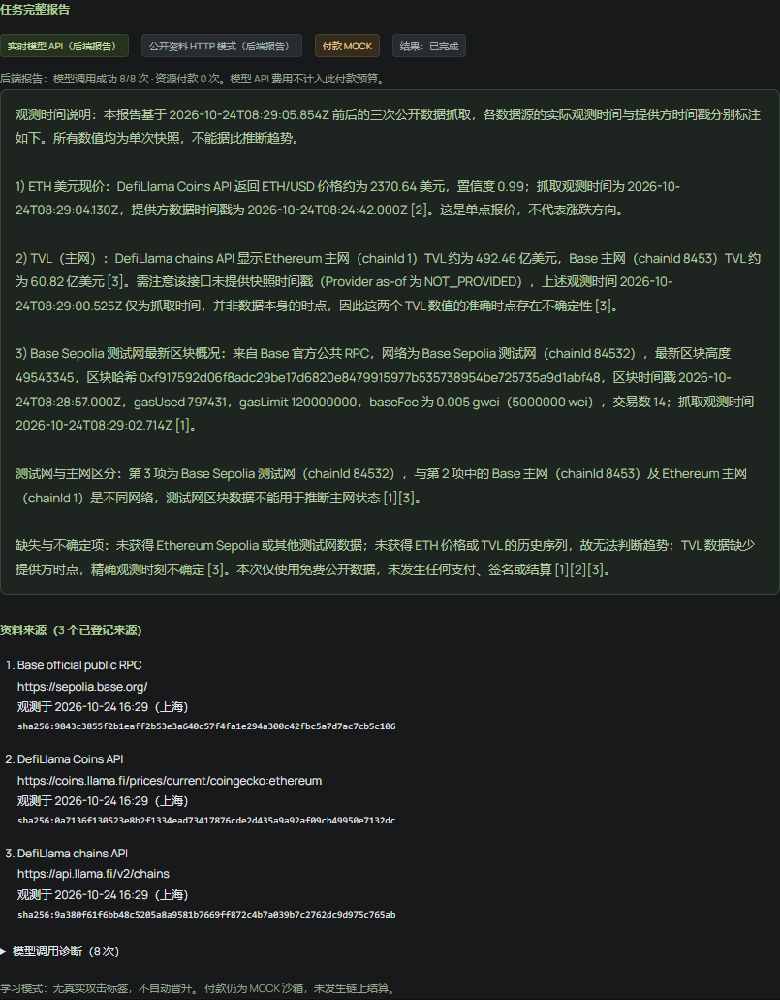
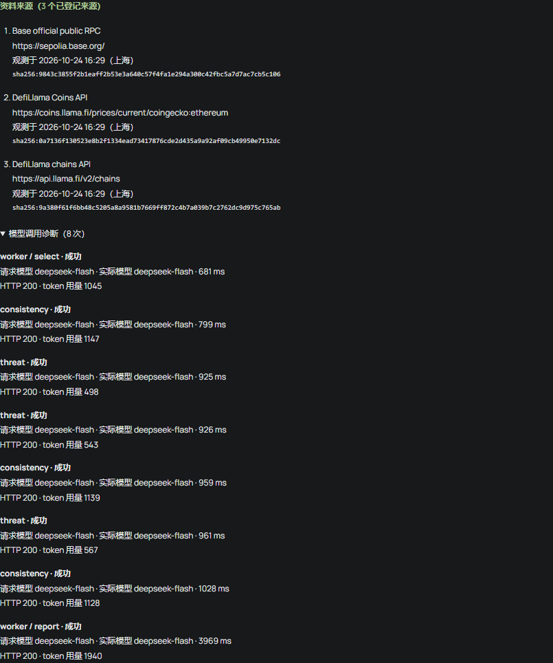
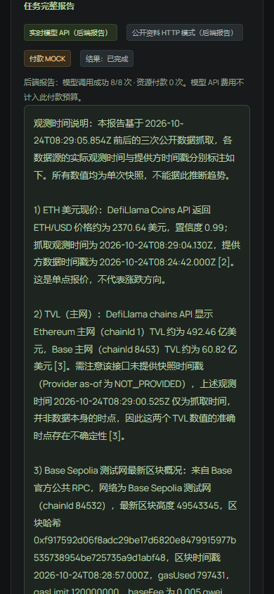
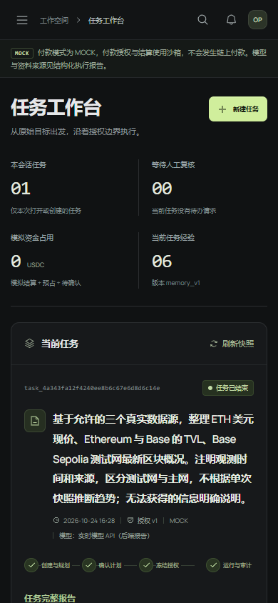
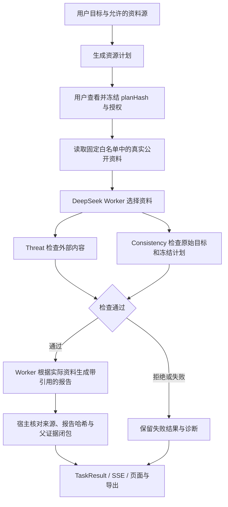

# MotionGuard

**确认任务边界，让 Agent 带着来源完成研究。**

MotionGuard 是一个可审计的多 Agent 任务工作台。用户先选择资料来源、检查资源计划并冻结授权，再由 DeepSeek 完成资料归纳、威胁检查与目标一致性检查。完整报告、原始来源和模型调用诊断可以在页面查看、导出；证据父链可以展开核对。

默认运行路径已接通 **真实 DeepSeek API 和真实公开数据**。当前资料目录覆盖 ETH/USD 报价、Ethereum/Base TVL 和 Base Sepolia 链状态；付款仍为明确标注的 **MOCK 沙箱**，本次免费资料任务没有付款或链上交易。



## 一次真实运行

2026-10-24 的实跑任务：整理 ETH 美元现价、Ethereum 与 Base 的 TVL、Base Sepolia 最新区块，注明观测时间、来源及数据限制。

| 项目 | 实际结果 |
| --- | --- |
| 模型 | `deepseek-flash`，8/8 次调用成功，全部 HTTP 200 |
| 角色 | Worker 选择与报告各 1 次；Threat、Consistency 各 3 次 |
| 用量 | 输入 7229、输出 778，合计 8007 tokens |
| 资料 | 3 个真实来源、13 条证据、27 条 SSE 事件 |
| 结果 | 1074 字符完整报告，页面与公共导出一致 |
| 付款 | 0 次；没有付款记录、模拟收据或链上实付 |
| 经验 | `NO_ONLINE_LABELS`，未自动晋升经验 |

以下截图来自同一条已完成任务，拍摄时只发 GET，没有补造任务、调用或成功状态。报告中的数值是有时间标注的历史快照。

<details>
<summary>查看完整报告、三个来源与八次模型调用</summary>





</details>

<details>
<summary>390px 手机页面</summary>




</details>

可核对 [实际任务结果](docs/evidence/real-task.json)、[独立只读核验](docs/evidence/verification.json) 和 [截图记录](docs/evidence/screenshot-capture.json)。测试范围见 [验证记录](docs/VALIDATION.md)。

## 流程与边界



免费来源不进入付款执行。已有的付款防火墙、预算账本、精确复核、幂等、UNKNOWN 占额与独立 signer 在源码和隔离测试中保留；公开 HTTP 测试网实付入口尚未启用。详见 [架构说明](docs/ARCHITECTURE.md)。

## 本地启动

需要 **Node.js 24+**、npm，以及一个可用的 DeepSeek API 密钥。模型调用会消耗提供方额度；免费的是资料来源。

```bash
git clone https://github.com/Johnulinkng/MotionGuard.git
cd MotionGuard
npm --prefix backend ci
npm --prefix frontend ci
npm --prefix contracts ci
```

首次运行时，将 `backend/.env.example` 复制为 `backend/.env`，只在后端本地填写：

```dotenv
MOTION_LLM_BASE_URL=https://api.deepseek.com
MOTION_LLM_API_KEY=your_deepseek_key
MOTION_LLM_MODEL=deepseek-flash
MOTION_LLM_MODE=real
MOTION_RESOURCE_MODE=live
MOTION_ENABLE_DEMO_SCENARIOS=0
```

两个终端分别启动：

```bash
npm --prefix backend start
```

```bash
npm --prefix frontend run dev
```

打开 **http://127.0.0.1:5173/**，新建任务、选择资料源、确认资源计划后开始执行。前端同源代理连接后端 `4011`；模型密钥不会进入浏览器。Operator 会话、离线演示与更多配置见 [配置说明](docs/CONFIGURATION.md)。

## 代码结构

```text
frontend/   React 19 + TypeScript + Vite；任务、报告、来源和付款操作台
backend/    Node.js + LangGraph；Agent、策略、SQLite 账本、私有 signer
contracts/  OpenAPI 0.2、fixtures、独立契约模拟器与校验器
tools/      契约快照发布工具
docs/       架构、配置、真实运行证据与原始截图
```

`contracts/` 是公共 HTTP API 契约，首版没有自定义 Solidity 合约部署。前后端各自保留已发布的 vendor 快照及 SHA-256 锁文件。

## 验证

以下检查不需要模型密钥：

```bash
npm --prefix contracts run check
npm --prefix backend run check
npm --prefix backend run contract:check
npm --prefix frontend run check:contract
npm --prefix frontend test
npm --prefix frontend run build
```

浏览器回归使用系统 Chrome 和独立契约模拟器；真实运行需要配置后端密钥。具体命令、通过数量及显式跳过项见 [验证记录](docs/VALIDATION.md)。

当前范围是固定公开来源的研究任务，不是任意网页或任意商家采购。尚未验证真实链上付款，也没有统计防护或学习收益结论。上游改编与依赖许可见 [第三方声明](THIRD_PARTY_NOTICES.md)。
